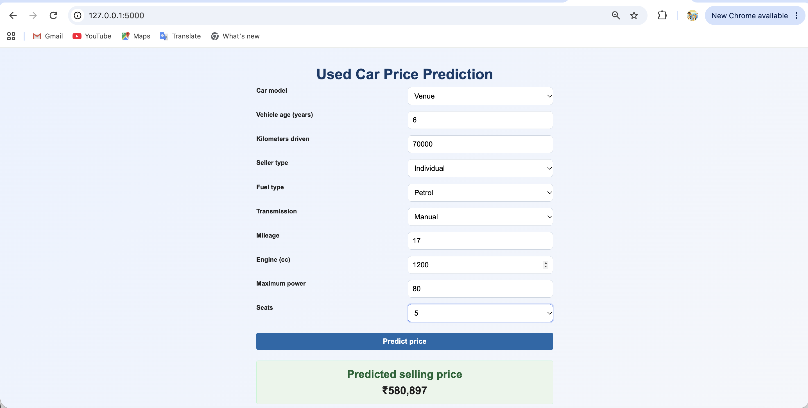
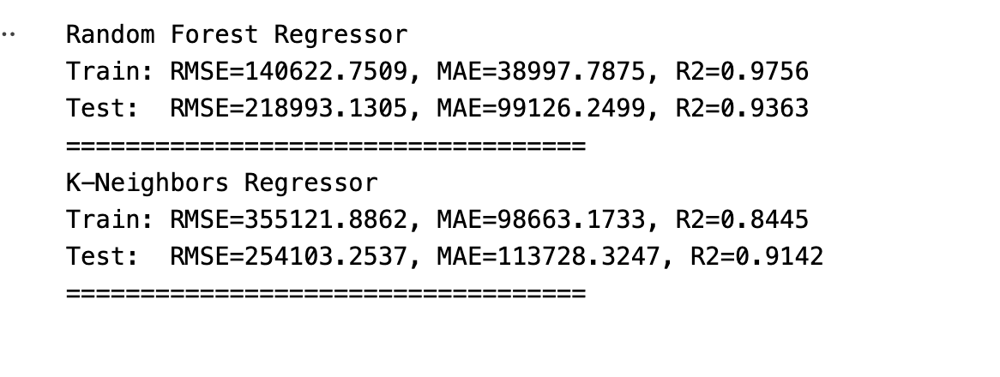

# Car Dekho Price Prediction
A machine learning web application that estimates the selling price of a used car from its specifications. Users enter car details through a Flask web page and receive a predicted price from a trained Random Forest model.

## Project Overview
This project covers the full workflow of a regression application:
- Preparing and exploring used-car data
- Encoding categorical features and scaling numerical features
- Training and evaluating regression models
- Saving the fitted model and preprocessing pipeline
- Connecting the model to a Flask application and HTML form

## Input Features
The application uses:
- Car model
- Vehicle age
- Kilometers driven
- Seller type
- Fuel type
- Transmission type
- Mileage
- Engine capacity
- Maximum power
- Number of seats

## Model Performance
On the held-out test set, the Random Forest model achieved:

| Metric | Test score |
| Mean Absolute Error (MAE) : 99,126 
| Root Mean Squared Error (RMSE) : 218,993
| R² score : 0.9363

MAE is the average absolute difference between predicted and actual prices. These scores describe performance on the test dataset; individual predictions can differ from actual selling prices.

Tech Stack

- Python — data preparation and model development
- Pandas and NumPy — data handling
- Scikit-learn — preprocessing, model training, and evaluation
- Flask — web application
- HTML and CSS — user interface

## Project Structure

## Project Structure

```text
Car_Dekho/
├── application.py
├── models/
│   ├── random_forest_model.pkl
│   └── preprocessor.pkl
├── templates/
│   └── index.html
├── static/
│   └── style.css
├── images/
│   ├── prediction-result.png
│   └── model-performance.png
├── requirements.txt
└── README.md
```

## Application Preview

Enter the car’s details in the web form and select **Predict price**. The app displays an estimated selling price based on the trained model.



## Model Performance

I compared the Random Forest Regressor and K-Neighbors Regressor using the test set. The Random Forest performed better, with lower test MAE and RMSE and a higher R² score.

- Random Forest: MAE 99,126; RMSE 218,993; R² 0.9363
- K-Neighbors: MAE 113,728; RMSE 254,103; R² 0.9142

MAE is the average absolute difference between the predicted and actual prices. The Random Forest’s test MAE means its predictions differed from actual prices by about ₹99,126 on average in this test set.



# RUN LOCALLY
1. Clone the repository
   git clone https://github.com/YOUR-USERNAME/YOUR-REPOSITORY.git
   cd YOUR-REPOSITORY
2. Create and activate a virtual environment
   python3 -m venv .venv
   source .venv/bin/activate
3. Install the required packages
   pip install -r requirements.txt
4. Start the Flask application
   python3 application.py
